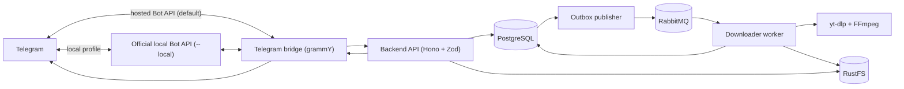

# Approved Architecture

Status: Approved and implemented; this document describes the current architecture\
Decision date: 2026-08-12

## 1. Scope

The MVP accepts public X (`x.com` and compatible legacy `twitter.com`) status links and returns the
downloaded video through Telegram. YouTube, TikTok, other source adapters, a web administration
panel, and authenticated/private-source downloads are later extensions.

The backend, worker, storage, queue, and Telegram bridge remain separate components even when
deployed together with Docker Compose.

## 2. Language and application runtime

- All application-owned services and shared packages use TypeScript on Deno 2.x.
- There is no Python application service.
- `yt-dlp`, FFmpeg, and ffprobe are external worker tools invoked as child processes through a
  narrow adapter.
- The worker image may contain Python as a runtime dependency of the selected yt-dlp distribution;
  this does not make Python part of the application API or domain model.
- `yt-dlp-ejs` is deferred until YouTube support. When enabled, the existing Deno executable will
  also run yt-dlp's external JavaScript challenge solvers.

## 3. Application stack

- HTTP API: Hono on `Deno.serve`.
- Runtime validation and shared contracts: Zod.
- API description: Zod-backed OpenAPI generation.
- Metadata, authorization, job state, delivery state, retention policy, audit history, and
  transactional outbox: PostgreSQL.
- Background-work broker: RabbitMQ.
- Telegram framework: grammY.
- Artifact storage: RustFS through the S3-compatible API.
- Deployment: Docker Compose.

Dependencies are pinned through the Deno lockfile and container image versions.

## 4. Component topology

The API, bridge, worker, outbox publisher, and cleanup scheduler use the same application image
with different entry commands. They do not import one another's transport-specific handlers.

## 5. Job and queue reliability

PostgreSQL is the source of truth; RabbitMQ is the durable work dispatcher, not the only record that
a request exists.

- API job creation and outbox insertion occur in one PostgreSQL transaction.
- Idempotency lookup happens only after requester authorization. The immutable policy snapshot also
  records whether retention was omitted or explicit: retries with omitted retention return the
  original job across deployment-default changes, while explicit/omitted or otherwise different
  client semantics conflict. Pre-marker jobs retain the legacy resolved-policy comparison.
- The outbox publisher sends only an opaque job ID using publisher confirmation and marks the outbox
  row published afterward.
- Work uses durable RabbitMQ quorum queues and persistent messages.
- Workers manually acknowledge a message only after the resulting PostgreSQL state transition is
  durable.
- Worker prefetch is deliberately small and configurable.
- The outbox has a dedicated 250 ms polling loop; retention cleanup keeps its independent, slower
  schedule. Declared worker concurrency controls consumer prefetch so two slots actually receive
  work in parallel.
- Retries use bounded delay queues and a dead-letter queue. Transient X metadata transport
  timeouts use a dedicated five-second delay queue; storage, broker, and other infrastructure
  failures retain the general 30-second delay.
- A worker obtains a PostgreSQL job lease before starting external processes.
- State transitions and artifact promotion are idempotent because RabbitMQ provides at-least-once,
  not exactly-once, execution.
- Delivery is a separate retryable operation; retrying Telegram delivery never redownloads the
  source.

Dramatiq is not used because it is a Python task framework and conflicts with the approved
full-TypeScript application. The TypeScript RabbitMQ client is `@cloudamqp/amqp-client` 4.0.0,
selected after a focused Deno/RabbitMQ compatibility and recovery test (see
[compatibility](compatibility.md)).

## 6. Download adapter and X-only policy

- The public API accepts one URL per MVP request.
- Only HTTPS X status URLs on explicitly approved hostnames and path shapes are accepted. Legacy
  Twitter links may be normalized only when their identity is preserved.
- yt-dlp's generic extractor is not exposed.
- A multi-video X status is the one supported source URL and deterministically selects its first
  video. Generic playlists, live streams, arbitrary yt-dlp options, user-provided output templates,
  and user-provided filenames are rejected.
- yt-dlp runs with fixed arguments, structured JSON metadata, and structured progress output.
  Ordinary human-readable stdout is not parsed. The validated metadata JSON is reused through a
  fixed child-process stdin channel so media fetches do not repeat X extraction; split video and
  audio tracks are fetched concurrently under one shared temporary-byte budget.
- The worker selects the best Telegram-compatible X format that remains below the configured
  artifact limit. FFmpeg merges or remuxes as necessary.
- The MVP does not transcode an oversized result. If no acceptable source format fits, the job fails
  with a specific size-policy error.
- ffprobe validates the completed artifact before it is promoted to ready state.
- X animated GIFs are silent video sources. Missing extractor duration is allowed; unknown size
  estimates retain the hard download and temporary-byte bounds, and ffprobe enforces the duration
  ceiling after download for every source. Standalone silent formats are selected when no separate
  audio stream exists. MP4-family probe names are normalized to `mp4`.

`TELEGRAM_MAX_UPLOAD_BYTES` is the bridge ceiling and `MAX_ARTIFACT_BYTES` is the worker artifact
ceiling; the latter must not exceed the former and both are strictly below 2,000,000,000 bytes.
`DOWNLOAD_MAX_TEMP_BYTES` is a per-job media budget, not a memory limit or a filesystem quota. It
must be at least `(2 * MAX_ARTIFACT_BYTES) + DOWNLOAD_FORMAT_SAFETY_BYTES`, covering separate input
streams plus a concurrently written remux output and the reviewed safety allowance. yt-dlp receives
a fixed `--max-filesize`, FFmpeg receives a fixed output bound, and the process wrapper also polls
the aggregate logical size of the job directory and terminates a child with the typed
`temp_storage_limit` error when the budget is exceeded.

Each claim uses an attempt-specific PostgreSQL lease owner. Its unique job directory contains a
service-owned marker with the same job, owner, and attempt identifiers. Healthy attempts refresh
that marker; startup and periodic recovery remove only marked, stale directories whose exact owner
no longer holds the durable lease. A newer attempt never reuses or clears an older attempt's
directory. Unmarked directories and mismatched artifact/marker attempt tokens are left untouched.

## 7. Artifact storage and retention

- RustFS starts as a private single-node S3-compatible service in Compose.
- Buckets are not public and object keys are opaque, for example `artifacts/{artifact_id}`.
- The database stores object key, checksum, size, media metadata, creation time, expiry, policy
  snapshot, and deletion state.
- Workers upload to a temporary object key and promote/finalize only after validation succeeds.
- Completed files are hashed incrementally and streamed from disk into multipart S3 upload; the
  worker does not allocate the whole artifact in memory.
- A ready artifact is reused by immutable X source ID before downloading. After a download, SHA-256
  plus byte size is checked both before upload and again under a PostgreSQL advisory transaction
  lock before the ready transition. A losing upload is removed and its job is attached to the
  canonical artifact.
- Shared-artifact expiry is the conservative union of every referencing job: `forever` and
  undelivered `after_delivery` mean no expiry; otherwise the latest calculated deadline wins.
- PostgreSQL controls `forever`, seven-day `ttl`, and `after_delivery` retention. RustFS lifecycle
  configuration is only a safety net for abandoned temporary objects.
- Terminal job history, audit events, and published outbox records default to a seven-day metadata
  TTL. A job is not purged while its artifact still exists.
- Cleanup claims rows idempotently and never deletes an artifact with an active delivery lease.
- A single-node RustFS deployment is not redundant. Any deployment using `forever` must have a
  separate backup policy.

## 8. Telegram bridge

- grammY is the bridge library because it is TypeScript-first, supports Deno, follows current
  Telegram Bot API types, and supports both hosted and local Bot API endpoints.
- The bridge uses long polling only, so exactly one polling instance may own a bot. Webhook mode
  is not implemented.
- The initial Bot API endpoint is Telegram's hosted `https://api.telegram.org`.
- The initial maximum upload/artifact size is configurable and defaults to 49,000,000 bytes, leaving
  margin below the hosted Bot API's documented 50 MB limit.
- The Bot API root is configuration. `compose.telegram-local.yaml` replaces it only for the
  `telegram-local` profile with the internal `http://telegram-bot-api:8081` service root; hosted and
  fake paths remain unchanged.
- The bridge replies to the requesting message with status, edits that reply as needed, changes it
  to `uploading` after a delivery lease is claimed, and replaces it with the result through
  `editMessageMedia` when possible.
- Telegram success is persisted before the bridge acknowledges delivery to the backend. Permanent
  edit failure falls back to sending a new reply and finalizing/removing the progress message.
- Delivery leases expose the artifact's validated video and audio codecs. The bridge sends silent
  H.264 MP4s as Telegram animations for both edits and fallback replies; other MP4s use video delivery.
- A claimed delivery is renewed every `TELEGRAM_DELIVERY_HEARTBEAT_SECONDS` from before the artifact
  stream opens through upload, fallback cleanup, and database finalization. Each renewal request is
  independently bounded by that interval. Renewal uses the existing delivery-ID/lease-owner
  compare-and-set; a false, failed, or timed-out renewal aborts cancellable fetch/stream work and
  prevents another Telegram call. Bridge shutdown uses the same cancellation path and leaves an
  unfinalized lease for normal expiry/recovery.
- Telegram acceptance can race renewal loss or process death. Edit retries always target the same
  progress message, and an ambiguous edit never triggers send-new fallback. A confirmed fallback
  result is stored as operation context before progress cleanup so restart can finalize it without
  sending again; the crash-after-send-before-persist boundary remains unavoidable because Telegram
  supplies no idempotency key for the new message.

The optional official local Bot API server is built from the reviewed Bot API 10.2 source commit
`adfd7f6a8e990272851777eeb3ae0def4216f161`, which pins its TDLib submodule. It runs with `--local`
and permits uploads up to Telegram's documented 2,000 MB ceiling. Its `TELEGRAM_API_ID` and
`TELEGRAM_API_HASH` operator secrets are injected only into that service. The BotFather token is
injected only into the bridge; as required by the Bot API protocol, the local server still processes
the token embedded in request URLs sent by the bridge. A dedicated network joins only these two
services, and the Bot API port is not published or routed through a public proxy.

## 9. Authorization and administration

- Access is default-deny and initially limited to private Telegram chats.
- `TELEGRAM_ADMIN_USER_IDS` contains one or more numeric Telegram user IDs used only to
  bootstrap/upsert administrators at startup.
- The normal allowlist is stored in PostgreSQL, not kept solely in environment configuration.
- Initial admin commands include `/allow`, `/deny`, `/users`, `/status`, `/cancel`, `/retry`,
  `/jobs`, `/requests`, and `/audit`, with authorization and an audit event for every mutation.
  Lists are bounded and paginated; non-administrators can list only their own jobs.
- Unknown users can create one deduplicated pending access request from `/request` or a valid first
  URL. No job is created and no download access is granted before an audited administrator allow.
  Requests and their safe numeric-ID notifications contain no profile or message text and expire
  after seven days. One notification row per active administrator and request revision is created
  transactionally; claim leases, bounded retry/backoff, terminal sent/skipped/failed states, and
  periodic active-admin reconciliation survive bridge restart and partial delivery. Telegram has no
  notification idempotency key, so a crash after Telegram accepts a message but before the sent
  state commits can produce a duplicate notification; the durable request and idempotent allow/deny
  actions remain authoritative. A recent denial suppresses repeated pending requests for the same
  period.
- Each safe administrator notification and each `/requests` row has a numeric-ID profile button and
  inline allow/deny controls. Telegram may restrict the profile link under the target user's privacy
  settings. Telegram has no native bot text modal, so a callback creates a durable, expiring
  decision prompt and sends a `ForceReply`. The administrator replies with an optional internal
  note, uses `/skip` for no note, or `/cancel_action` to leave the request pending. An active prompt
  pauses new access-request notification claims only for that administrator; other administrators
  and bridge work continue. The note is stored on the principal/request and in audit data but is
  excluded from requester-visible decision notices and sanitized `/audit` output.
- Button denial resolves only the current request. A principal is not created or disabled, and the
  request may reopen after `ACCESS_REQUEST_DENIED_COOLDOWN_SECONDS`. `/deny` remains the explicit
  persistent disable/revoke operation. Requester decision notices have their own durable leased
  outbox and the same unavoidable Telegram crash-after-send duplicate boundary.
- Access requests, `/allow`, and `/deny` take the same target-scoped advisory transaction lock after
  administrator authorization and before target/request reads. This gives nonexistent targets the
  same serialization as existing rows and makes request, principal, and notification resolution one
  consistent outcome under concurrency.
- The bridge installs a private-chat user command menu plus per-admin chat scopes with
  `setMyCommands` at startup. Registration is bounded and best-effort: failure is warned but does
  not block readiness, intake, or delivery. These menus are discoverability hints only; backend
  authorization is still authoritative.
- Usernames and display names are informational only; authorization uses stable numeric IDs in
  canonical decimal form: positive, no leading zero, and no greater than JavaScript's maximum safe
  integer.
- A web admin panel is deferred and must later consume the same administration API.

## 10. Test and coverage policy

- `deno fmt`, `deno lint`, type checking, tests, and coverage are mandatory CI gates.
- Core application packages have a minimum 80% line-coverage gate. Branch and function coverage are
  reported and must not materially regress.
- Acceptance-critical behavior must be tested regardless of aggregate coverage: authorization, URL
  policy, job transitions, outbox recovery, duplicate delivery, retries, cancellation, all retention
  modes, cleanup, and secret redaction.
- Unit tests use captured yt-dlp metadata/progress fixtures.
- Integration tests use disposable PostgreSQL, RabbitMQ, and S3-compatible services through a
  dedicated Compose test profile.
- Telegram contract tests use a fake Bot API server, including upload failure, timeout, retry, and
  message-edit fallback behavior.
- Normal CI does not depend on X or Telegram availability. A separate manually triggered smoke test
  may exercise a controlled public X post (see [verification](verification.md)).

Coverage percentage is a floor, not a substitute for state-machine, recovery, and integration tests.

## 11. Compose services

The deployment contains:

- `api`
- `worker`
- `telegram-bridge`
- `maintenance` (outbox publisher and scheduled cleanup entry point)
- `postgres`
- `rabbitmq`
- `rustfs`
- `rustfs-init` for private bucket initialization
- `loki` for seven days of structured application logs
- `prometheus` for seven days of scraped time-series metrics

The worker's `/var/tmp/video-downloader` path is a dedicated `worker-temp` named volume. Only its
small general-purpose `/tmp` remains tmpfs-backed. The media volume is independent of the 768 MiB
worker memory limit and persists across container replacement long enough for marked abandoned
attempt reconciliation; it is temporary operational state, not an artifact backup.

The official `telegram-bot-api` service is optional and disabled initially. The dedicated
`telegram-local` override supplies its health check, named working-directory volume, non-root and
read-only runtime, dropped capabilities, resource/PID limits, and graceful shutdown window. It does
not enable any `test` service.

The Dokploy production definition is standalone rather than a multi-file override. It includes the
official local server, removes every host port, separates internal backend and observability
networks from worker-only and Telegram-only egress networks, and bakes Loki/Prometheus configuration
into immutable images. Its bridge replica count defaults to zero so infrastructure and local Bot API
health can be established before any operator-controlled hosted-to-local account migration. Once
the bot is on the local server the operator changes that count to one; the bridge then waits for
the API, worker, maintenance, and local Bot API health checks.

Application services keep JSON on stdout and asynchronously push the same redacted entry to Loki.
Loki failures never fail a request or job. Docker's `json-file` driver is size-rotated as a short
fallback. Prometheus scrapes each service's internal `/metrics` endpoint; both observability stores
use dedicated persistent volumes and enforce 168-hour retention.

## 12. Secrets and live-test timing

No Telegram credentials are required to implement the domain model, API, worker, queue, storage,
bridge logic, or automated test suite.

The first real Telegram end-to-end test needs:

- `TELEGRAM_BOT_TOKEN` from BotFather;
- the operator's numeric ID in `TELEGRAM_ADMIN_USER_IDS`.

Only the opt-in local Bot API deployment also needs:

- `TELEGRAM_API_ID`;
- `TELEGRAM_API_HASH`.

PostgreSQL, RabbitMQ, and RustFS credentials are deployment secrets generated for the environment.
They and all Telegram credentials stay in an ignored local env file or secret store and are never
committed. Public X downloads do not require source-account cookies for the MVP.
